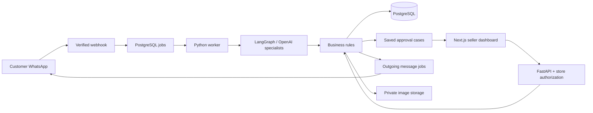

# Architecture

## Request path

The demo inbox calls the same conversation/business services through a development-only route. It does not send WhatsApp messages. Data shown in the dashboard is retrieved from FastAPI; the browser does not write business tables directly.

## Responsibilities

- HTTP routes authenticate the actor, validate input, and delegate to domain services.
- Conversation routing proposes an intent using an OpenAI function schema. Shopping and Resolution specialists refine extracted details in live AI mode.
- Policy AI returns a draft. Only an owner can publish a version.
- Vision AI describes observable evidence with uncertainty. Its output cannot authorize actions.
- Insights AI summarizes source reviews and requests through an explicit analysis endpoint. Dashboard counts remain deterministic.
- Commerce services own eligibility, final price calculation, required approvals, inventory, and financial caps.
- PostgreSQL records are the source of truth. LangGraph checkpoints preserve individual agent runs; persistent `cases` implement approval waits across restarts.

## Case states

`pending_seller -> pending_customer -> completed`

Alternative transitions: `needs_details -> pending_seller`, `rejected`, `declined`, and `expired`. Cases expire after 24 hours. Jobs persist expiration work. Seller approval is separate from customer acceptance. Customer confirmations carry a specific case ID and are checked against the original conversation.

Before executing, the backend rechecks the policy version, order status, inventory, capacity, previously refunded amount, and remaining paid balance. Money is stored as integer paise. Tax calculations use integer rounding. Row locks serialize concurrent access to stock, orders, reservations, and cases. Execution and audit events commit in the same transaction.

Messages have unique IDs. Duplicate incoming messages and repeated completed-case confirmations cannot repeat a business operation. A sender can access only orders mapped to their customer record. Guessing an order ID is insufficient.

## Storage and access

Supabase Auth JWTs are checked against issuer, audience, expiration, signature, and a database membership. Owners manage policies, approvals, and product pricing. Member reads and operations remain merchant-scoped.

Application tables have PostgreSQL RLS enabled, with no direct client policies. LangGraph tables live in the private `rescueloop_agents` schema. The server database role must be a trusted backend role with the required access. Private storage access is mediated by the API, returning short-lived URLs or authenticated local files. Uploads are limited to 8 MB and 20 megapixels, decoded, resized, and re-encoded to strip metadata.

## Worker behavior

Jobs use `FOR UPDATE SKIP LOCKED` and a three-minute lease. Failed inbound work retries up to five times with a delay. Outgoing delivery is marked `sending` before calling Meta. Ambiguous delivery outcomes become `needs_review`; the worker does not automatically resend and risk duplicate customer notifications. No exactly-once network-delivery guarantee is claimed.

WhatsApp template configuration is required outside the messaging window. The configured template must accept one body parameter containing the update. Provider version, phone ID, credentials, and template approval must be verified in the Meta account during live setup.

## Boundaries

Payments and courier operations are intentionally mocked. Customer consent, approvals, cases, reservations, order mutations, evidence, and audit logs are real persisted demo records. Logs contain action summaries and results, not hidden model reasoning.
